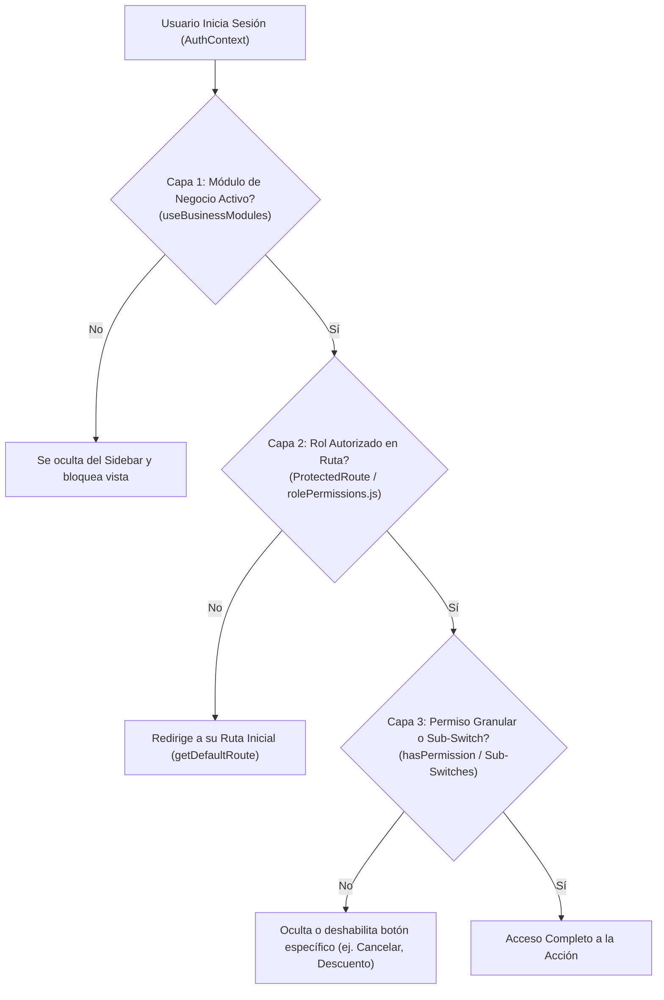

# 06 - Control de Acceso, Módulos y Roles en la UI (`puntogo-web`)

El Frontend de PuntoGo implementa una arquitectura de **Seguridad de 3 Capas** sincronizada con el Backend para que cada usuario vea únicamente las pantallas, pestañas y botones autorizados para su negocio y su puesto.

---

## 1. Las 3 Capas de Control en el Frontend

---

## 2. Capa 1: Módulos de Negocio Estilo Odoo (`useBusinessModules.js`)

Al iniciar sesión, el backend devuelve el mapa `businessModules` del negocio. El hook `useBusinessModules()` expone `isModuleEnabled(key)` para prender o apagar módulos enteros sin tocar código:

| Clave de Módulo (`key`) | Vista Principal Asociada | Sub-Switches Operativos Incluidos |
| :--- | :--- | :--- |
| `cashier` | `/cashier` (Punto de Venta) | `cashierDiscountsEnabled` (Descuentos), `cashierTierPricesEnabled` (Mayoreo/Especial), `cashierTipsEnabled` (Propinas), `cashierQuotesLoadEnabled` (Cargar Cotización), `cashierSalesHistoryEnabled` (Ver ventas del turno). |
| `cash_shift` | `/cash-shift` (Turnos y Caja) | `cashShiftBlindCutEnabled` (Corte Ciego: oculta el efectivo esperado al cajero). |
| `orders` | `/orders` (Historial de Órdenes) | `ordersCanCancel` (Permitir cancelaciones), `ordersCanReturn` (Permitir devoluciones parciales/totales). |
| `products` | `/products` (Catálogo) | `productsOptionGroupsEnabled` (Modificadores/Extras), `productsSatCodesEnabled` (Claves SAT). |
| `inventory` | `/inventory`, `/warehouses`, `/purchases` | `inventoryMultiWarehouseEnabled` (Multi-Almacén), `inventoryRecipesEnabled` (Recetas/Insumos), `inventoryPhysicalCountEnabled` (Auditorías ciegas). |
| `quotes` | `/quotes` (Cotizaciones) | `quotesDimensionsEnabled` (Cálculo automático por $m^2$ Ancho x Alto). |
| `customers` | `/customers` (Clientes CRM) | `customersCreditEnabled` (Cuentas por cobrar / Fiado), `customersPromotionsEnabled` (Campañas Email/WhatsApp). |
| `hr` | `/hr` (Recursos Humanos) | `hrAttendancePinEnabled` (Reloj checador por PIN), `hrDocumentsEnabled` (Expediente digital), `hrPayrollEnabled` (Cálculo de nómina). |
| `kitchen` | `/kitchen` (Pantalla KDS) | `kitchenSoundAlertsEnabled` (Alertas sonoras al recibir comanda). |
| `delivery` | `/delivery` (Apps Delivery) | Integración de webhooks y simulador de Rappi / DiDi Food. |
| `online_store` | `/store-settings` y `/tienda/:slug` | Portal público de comercio electrónico y pedidos por WhatsApp. |

---

## 3. Capa 2: Roles del Sistema y Rutas por Defecto (`rolePermissions.js`)

Cada usuario tiene asignado un rol principal que determina su pantalla de aterrizaje (`getDefaultRoute(user)`) al iniciar sesión:

| Rol | Nivel | Ruta Inicial por Defecto | Alcance Principal |
| :--- | :---: | :--- | :--- |
| `SUPERADMINISTRADOR` | 100 | `/dashboard` | Control global SaaS, licencias, mantenimiento global, multi-empresa y todos los módulos. |
| `ADMINISTRADOR` | 90 | `/dashboard` | Dueño de negocio: acceso total a configuración, reportes financieros, sucursales, personal y módulos de su empresa. |
| `GERENTE` | 75 | `/dashboard` | Supervisión operativa, cortes de caja, autorización de cancelaciones, compras, inventario y RRHH. |
| `CAJA` | 50 | `/cashier` | Punto de venta, apertura/cierre de turno, órdenes, cotizaciones y clientes. |
| `VENTAS` | 45 | `/quotes` | Atención a mostrador, levantamiento de cotizaciones ($m^2$), clientes y órdenes. |
| `ALMACEN` | 40 | `/inventory` | Kardex de inventario, conteos físicos, almacenes, transferencias y recepción de compras. |
| `MESERO` | 30 | `/cashier` | Toma de comandas en punto de venta y seguimiento de órdenes. |
| `COCINA` | 20 | `/kitchen` | Exclusivo para pantalla KDS de preparación de alimentos y bebidas. |

---

## 4. Capa 3: Permisos Granulares y Autorización con Contraseña

Además del rol y módulo:
* **`hasPermission('modulo.accion')`**: Verifica permisos puntuales en la matriz RBAC configurada en `PermissionsPage.jsx`.
* **Autorización de Supervisor en Caja (`RequestCancellationModal.jsx` / `AdminCancelOrderModal.jsx`)**: Si un cajero no tiene permiso directo para cancelar una orden pagada, puede enviar una **Solicitud de Cancelación** con motivo, o un Gerente/Administrador puede autorizarla ingresando sus credenciales.

