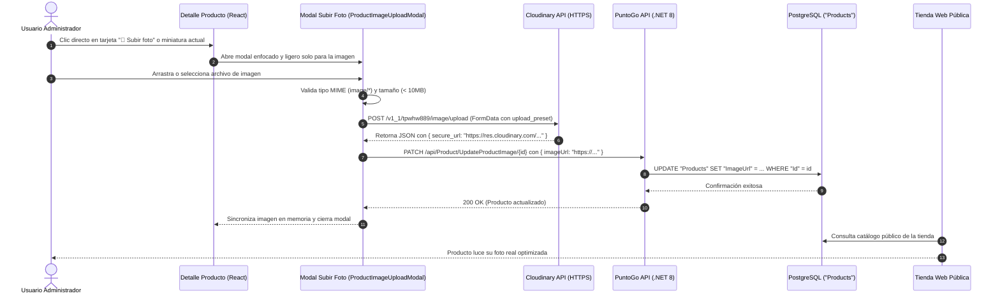

# 09 - Integración de Imágenes con Cloudinary CDN

Este documento describe la arquitectura, configuración técnica y flujo de implementación utilizado en **PuntoGo** para la subida, almacenamiento y distribución de imágenes de productos en el Punto de Venta y en la Tienda en Línea Oficial (`/tienda/:slug`).

---

## 1. Justificación y Objetivos de la Arquitectura

Para permitir que cada negocio asigne fotografías reales a sus productos sin saturar el servidor local ni la base de datos PostgreSQL, se integró **Cloudinary** como red de entrega de contenidos (CDN) y almacenamiento de objetos multimedia:

* **Desacoplamiento de Almacenamiento:** El servidor de base de datos y la API de .NET 8 no guardan archivos binarios pesados en disco ni en columnas `bytea`, únicamente almacenan la URL HTTPS generada (`ImageUrl`).
* **Optimización Automática:** Cloudinary comprime y convierte imágenes pesadas (JPG/PNG de smartphones) a formatos web de última generación (**WebP** o **AVIF**) en tiempo real, garantizando que el catálogo de la tienda en línea cargue al instante incluso en redes móviles.
* **Seguridad sin Exposición de Claves Secretas:** Se implementó mediante el modo **Unsigned Upload Preset**, permitiendo que el navegador del usuario suba la imagen de forma directa y autenticada sin exponer la `API Secret` de la cuenta de Cloudinary.

---

## 2. Credenciales y Configuración de Cloudinary

| Parámetro | Valor Configurado | Descripción |
| :--- | :--- | :--- |
| **Cloud Name** | `tpwhw889` | Identificador único del espacio en la nube de Cloudinary |
| **Upload Preset** | `puntogo_products` | Perfil de subida preconfigurado en Cloudinary |
| **Signing Mode** | `Unsigned` | Permite subidas directas desde clientes web sin firma del backend |
| **Límite de Peso** | `10 MB` | Tamaño máximo permitido por imagen |
| **Formatos Aceptados** | `image/jpeg`, `image/png`, `image/webp` | Extensiones estándar para catálogos comerciales |

---

## 3. Flujo de Trabajo (Arquitectura Técnica)

---

## 4. Componentes y Archivos Clave

### A. Modal Independiente de Imagen (`src/components/products/ProductImageUploadModal.jsx`)
* **Propósito Único:** Evita sobrecargar el modal general de *Editar Producto*, permitiendo una gestión rápida, limpia y atómica de la fotografía.
* **Área Interactiva y Drag & Drop:** Permite arrastrar una imagen o presionar el recuadro para abrir el selector nativo de archivos.
* **Vista Previa Ampliada:** Si el producto ya cuenta con foto, la despliega en tamaño grande (180x180px) con botón de **"📷 Cambiar Foto"** y **"🗑️ Quitar Foto"** (que envía `null` vía PATCH).
* **Control de Carga:** Spinner animado que indica el progreso en Cloudinary y bloquea dobles envíos.

### B. Servicio Cliente (`src/services/cloudinaryService.js` y `productService.js`)
* **`uploadImageToCloudinary(file)`**: Realiza validaciones en el cliente (tipo MIME y límite de 10 MB), construye el `FormData` con el preset `puntogo_products` y ejecuta el `fetch` al endpoint `https://api.cloudinary.com/v1_1/tpwhw889/image/upload`.
* **`productService.updateImage(id, imageUrl)`**: Envía una petición `PATCH /api/Product/UpdateProductImage/{id}` para modificar exclusivamente el campo `ImageUrl` sin necesidad de enviar todo el formulario comercial del producto.

### C. Catálogo y Panel de Detalle (`src/components/products/ProductCatalogTab.jsx`)
* **Tarjeta Rediseñada de Foto:** En lugar de botones sobrepuestos, cuenta con una tarjeta limpia de `68x68px` con bordes redondeados (`border-radius: 12px`).
  * Si no tiene foto: Muestra un recuadro suave con borde punteado, icono `📸` y la leyenda `Subir foto`.
  * Si ya tiene foto: Despliega la miniatura con efecto hover `📷` para cambiarla.
* **Tabla General:** Incluye una miniatura de `28x28px` al lado de cada nombre para ubicar qué artículos ya tienen foto.

### D. Formulario de Edición General (`src/components/products/ProductFormModal.jsx`)
* **Despejado y Liviano:** Se removió la subida de foto de este modal para mantenerlo ágil, enfocado únicamente en precios, costos, descuentos, códigos, inventario y facturación CFDI 4.0.

### E. Backend .NET 8 (`PuntoGo.Api`)
* **Controlador (`ProductController.cs`):** Endpoint `[HttpPatch("UpdateProductImage/{id:int}")]` protegido con el permiso `products.manage`.
* **Servicio (`ProductService.cs`):** Método `UpdateProductImageAsync(int id, string? imageUrl)` que ejecuta un `UPDATE` puntual sobre la columna `ImageUrl` en PostgreSQL.

---

## 5. Mantenimiento y Buenas Prácticas

1. **Rotación de Presets:** En caso de requerir cambiar las reglas de subida o crear carpetas específicas dentro de Cloudinary (ej. `products/`), basta con editar la constante `uploadPreset` en `cloudinaryService.js`.
2. **Monitoreo de Cuota:** La cuenta gratuita de Cloudinary ofrece **25 GB de almacenamiento y 25,000 transformaciones mensuales**, suficiente para decenas de miles de productos. El consumo puede auditarse directamente desde el panel de Cloudinary en *Settings > Usage*.
3. **Eliminación Lógica:** Cuando un usuario presiona **"✕ Quitar"** en el formulario, el campo `ImageUrl` se envía como `null` a la base de datos, retirando la foto de la tienda web de inmediato.
